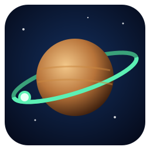

<p align="center">
  
</p>

# Zone of the Enders Recompiled - Android

The Android port of [Zone of the Enders Recompiled](https://github.com/almost-drowned-rat/ZoneOfTheEnders-Recompiled),
the static recompilation of *Zone of the Enders* (PlayStation 2, USA, SLUS-20148). One app: you choose your own disc
image, the game is translated and compiled **on your device** once, and then it plays - with a gamepad, a handheld's
own controls or touch buttons.

> This project contains **no game data, no game code and no keys**. You need your own copy of the game (USA disc
> image). The app never contains any of the game's code: it is built on your device from your own disc.

> **AI disclosure:**  AI assistance yes (Claude Code by Anthropic).

> **Early release, tested on one device.** I have tested this port only on an AYN Odin 2 Portal (Snapdragon 8 Gen 2,
> Adreno 740). Other devices may work, but I could not test them; reports are welcome.

---

## Status

**v0.8.5** - the same version as the Windows / Linux port it is built from
([v0.8.5](https://github.com/almost-drowned-rat/ZoneOfTheEnders-Recompiled/releases/tag/v0.8.5)). Download the APK
from [Releases](https://github.com/almost-drowned-rat/ZOE-Recompiled-Android/releases) and install it (Android 10+,
arm64). It is signed with the project's own key - every later update installs over it.

Updates install over the previous version and keep your saves. To get them automatically, add this repository to
[Obtainium](https://github.com/ImranR98/Obtainium) (`https://github.com/almost-drowned-rat/ZOE-Recompiled-Android`).

| Device | Chip / GPU | Driver | Result |
|---|---|---|---|
| AYN Odin 2 Portal (Android 13) | Snapdragon 8 Gen 2 / Adreno 740 | purple-turnip T30 | runs; first start ~12 min; boss fight ~59 fps |

## Requirements

- Android 10 or newer, **arm64** (64-bit ARM)
- A GPU with a **Vulkan 1.3** driver. On Snapdragon (Adreno) a **Turnip** driver package (`.adpkg.zip`) is
  recommended - tested with **purple-turnip T30**
  ([`turnip_mrpurple_T30-toasted.adpkg.zip`](https://github.com/MrPurple666/purple-turnip/releases/tag/vturnip_mrpurple_T30-toasted.adpkg),
  Mesa Turnip 26.3.0, by MrPurple666). No driver comes with the app. With the Adreno 740's own driver, FSR upscaling
  drew the picture wrong in my tests.
- Your own **Zone of the Enders (USA, SLUS-20148)** disc image (`.iso`)
- Optional, for the **Japanese voices**: the Japanese disc image (**SLPM-65019**) **and** the subtitle pack
  `ZOE-subtitles.pak` from the [PC release](https://github.com/almost-drowned-rat/ZoneOfTheEnders-Recompiled/releases/tag/v0.8.5)
- Free storage: about **8 GB** during the first start (each image is copied in and unpacked; the copies are deleted
  again), about **4 GB** after it. The build uses as many processor cores as the memory allows (about 1.4 GB
  each): less RAM only makes the first start slower.

## How it works

1. Install the app and start it. The setup screen opens.
2. **Browse...** your disc image - and, if you like, the Japanese disc and the subtitle pack.
3. **Graphics driver (change...)**: keep the *system driver*, or choose *Turnip driver from a file* and pick the
   `.adpkg.zip`. You can change it any time later in the BACK menu.
4. **Install.** The game's code is translated and compiled on the device, then your discs are unpacked into the app's
   folder - **once**, about 12 minutes on a Snapdragon 8 Gen 2 (and once more after an app update). Keep the app
   open; the screen stays on. **Quit** asks first, then stops cleanly.
5. **Play.** Every later start goes straight into the game. After an app update the setup comes back once and
   builds the game again from the files you chose (one tap).

Your disc images are only read, never changed or deleted.

**Frame rate at first:** every new effect, scene or menu needs its shaders built once on the device. The frame rate
drops now and then at the beginning and gets better the longer you play; the shaders are kept for the next time.

## Features

- **The whole game, native on your device** - no emulator: the PS2's program, its vector units and its sound
  processor are translated to C++ and compiled for arm64; the picture is drawn with **Vulkan**.
- **Built from your own disc, on the device** - the app carries no game code; the first start (about 12 minutes on a
  Snapdragon 8 Gen 2) translates, compiles and unpacks once, then every start goes straight into the game.
- **One setup screen** - your USA disc image, optionally the Japanese disc and the subtitle pack, and the graphics
  driver; **Quit** asks first, then stops cleanly.
- **Graphics driver of your choice** - the system driver or a **Turnip** package (`.adpkg.zip`) from a file; up to 5
  packages are kept and can be switched in the BACK menu. No driver comes with the app.
- **Everything of the [PC port](https://github.com/almost-drowned-rat/ZoneOfTheEnders-Recompiled#features)** -
  RECOMP OPTIONS in the game's own OPTIONS menu:
  - POST PROCESSING: antialiasing (FXAA, SMAA, SSAA 2x / 4x), anisotropic filter, bloom, upscaling (bilinear / FSR 1)
  - DISPLAY: render resolution up to 5x, aspect ratio 4:3 / 16:9 / 16:10 / 21:9 (widened, never stretched), field of
    view (Android always runs full screen, so there is no display-mode line)
  - PERFORMANCE: V-sync, FPS, frame time, game speed
  - RENDERING: texture filtering (*auto* is *fast* on Android), shader compile mode, shader notice
  - LANGUAGE: subtitles, voices, subtitle language
- **The Japanese voices** - with your Japanese disc and the subtitle pack: the original Japanese cast, with subtitles
  in English, French, German, Italian, Spanish or Japanese.
- **Gamepads and handheld controls** as a DualShock 2, **with rumble**.
- **Touch buttons** - a full DualShock 2 on the screen; move, resize or hide single buttons, opacity, stick
  sensitivity; on *Automatic* they hide while a gamepad is used.
- **BACK menu** - controls, saves export / import, log export, boot animation, graphics driver, licences.
- **Shaders kept** - every effect's shaders are built once on the device and kept for the next time.
- **Always landscape**, the screen stays on during the setup.

## Controls

- **Gamepads** and a handheld's own controls work out of the box, as a DualShock 2.
- **Touch:** DualShock 2 buttons on the screen (sticks, D-pad, the four face buttons, L1 / L2 / R1 / R2, START /
  SELECT). With the touch buttons on *Automatic* they hide while a gamepad is used.
- **BACK** opens a menu that slides in from the left:
  - **Back to game**
  - **Controls** - touch buttons on / off / automatic, the connected controllers, move and resize the touch
    buttons, button size, hide single buttons, opacity, stick sensitivity, reset the layout
  - **Settings** - **Saves** (export / import), **Export log**, **Boot animation**, **Graphics driver** (the system
    driver or up to 5 kept Turnip packages), **About and licences**

## Your files

```
/storage/emulated/0/Android/data/io.github.almostdrownedrat.zoe/files/
  memcard/          your saves
  pc_settings.ini   your settings
  game/             your discs, unpacked, and the subtitle pack
  data/logs/        the logs (setup.log: the first start) - please attach them to a bug report
```

**Uninstalling the app deletes this folder too** - back up your saves first (BACK > Settings > Saves > Export).

## Troubleshooting

| What you see | What to do |
|---|---|
| "App not installed" | the app needs Android 10+ on arm64 |
| "This is not the Zone of the Enders (USA) disc" | choose the USA image (SLUS-20148); the Japanese one goes in the second line |
| The setup stops with "... failed" | the message names the step; `files/data/logs/setup.log` (see *Your files*) has the details - please open an issue with it |
| Black or broken picture | try the other driver (BACK > Settings > Graphics driver), or turn FSR off |

## Building from source

- The app: `packaging/android` (Gradle; `jni/` holds the app's native parts: the Vulkan driver loader shim, the touch
  pad, and the small launchers for the on-device Python, linker and the game's disc unpacker).
- The first-start kit inside the APK (`assets/setup`): made by `packaging/android/make_setup_assets.py` from the PC
  release's payload, the toolkit built for Android with the NDK (`games/zoe_us/port` with the NDK's CMake toolchain),
  an LLVM toolchain that runs on Android, the NDK's sysroot and libc++, and python.org's CPython for Android.
- v0.8.5's kit carries one file newer than the PC release: the toolkit's `tools/translate.py` with a fallback for
  Python builds without `multiprocessing` (Android); it goes into the toolkit for the next release.

## Credits and licences

- Everything listed in the [PC port's credits](https://github.com/almost-drowned-rat/ZoneOfTheEnders-Recompiled#credits-and-licences).
- On Android also: LLVM / clang / lld (Apache-2.0 with LLVM exception), the Android NDK's sysroot and libc++
  (Apache-2.0 with LLVM exception / BSD), CPython (PSF License), libadrenotools (BSD-2-Clause). The licence texts are
  in the APK (`assets/licenses`) and in the app (BACK > Settings > About and licences).

This project is licensed under the GNU General Public License v3.0 (see `LICENSE`).

*Zone of the Enders* is a trademark of its owners. This project is not affiliated with, endorsed by or sponsored by
the game's publisher or developer.
